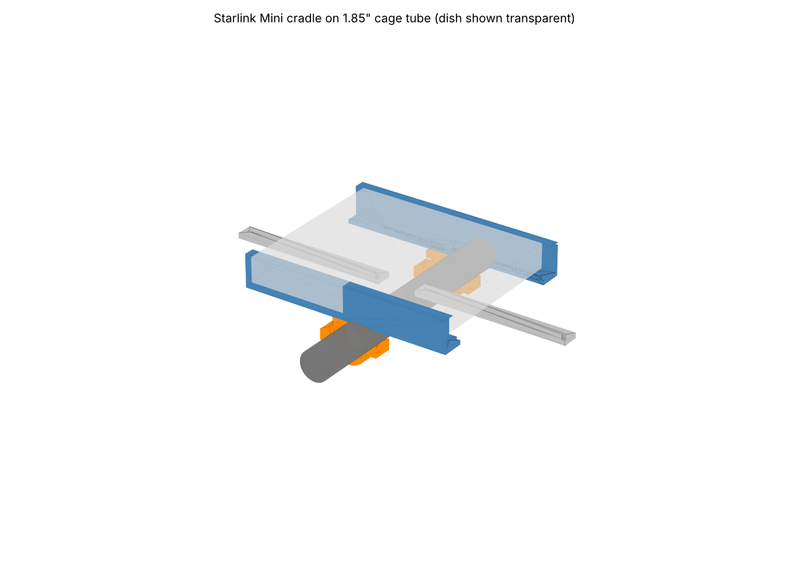
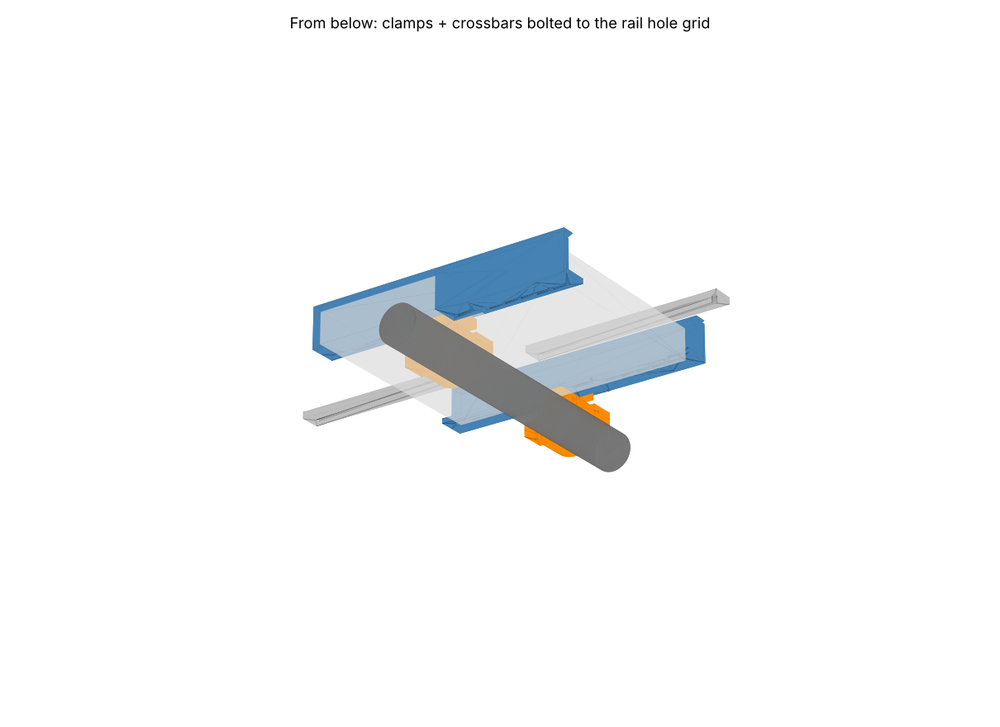

# Starlink Mini roll-cage mount for Can-Am (3D printed)

A printable cradle that holds a **Starlink Mini** on a round roll-cage tube of a
Can-Am Maverick X3 / Commander / aftermarket cage. Everything is parametric
OpenSCAD; ready-to-slice STLs are in `stl/`.



## How it works

* Two **C-channel side rails** capture the dish's long edges (298.5 mm side).
  Each rail is printed in two halves (rear + front) joined with a half-lap and
  two M5 bolts, so every part fits a 220 mm bed.
* The rails bolt **directly onto two split tube clamps** that sit on one cage
  tube running *across* the dish (perpendicular to the rails). Clamp versions
  are supplied for 1.75", 1.85" (Maverick X3 OEM) and 2.00" tube.
* Two **crossbars** tie the rails together at the ends. Print them, or use
  1" x 1/8" aluminum flat bar cut to 240 mm with 5.5 mm holes 220 mm apart.
* The rails have a **row of M5 holes every 20 mm** on the underside, so the
  clamps and crossbars can go on any row: slide the cradle fore/aft to balance
  it over the tube, or use four clamps on two parallel tubes.
* The dish slides in from the front. Rear corner stops locate it; a small
  bolt-on **retainer** at each front corner keeps it from sliding out. The
  stops are only 12 mm wide at the corners, so the cable port on the short
  edge stays clear in either orientation.



## Parts to print

| Part | Qty | Size (mm) | Notes |
|---|---|---|---|
| `rail_rear_L` / `rail_rear_R` | 1 each | 202 x 34 x 51 | mirrored pair |
| `rail_front_L` / `rail_front_R` | 1 each | 164 x 34 x 51 | mirrored pair |
| `retainer_L` / `retainer_R` | 1 each | 16 x 30 x 41 | |
| `crossbar` | 2 | 240 x 25 x 8 | or aluminum flat bar |
| `clamp_top_<size>` | 2 | ~92 x 30 x 40 | pick your tube size |
| `clamp_bottom_<size>` | 2 | ~92 x 30 x 32 | pick your tube size |

Total plastic is roughly 420 g in the 1.85" configuration.

### Print settings

* **Material: ASA or PETG. Do not use PLA.** A UTV roof in the sun exceeds
  PLA's softening point. ASA is the best choice for UV.
* 0.2 mm layers, 4 walls, 5 top/bottom, 40 %+ infill (gyroid or cubic).
* Rails: lay them on the **outer wall face** (the flat 51 mm tall side).
  No supports needed; the front lip has a built-in chamfer.
* Clamps: print on the flat split face. No supports.
* Crossbars and retainers: flat, as exported.

### Hardware

| Item | Qty | Use |
|---|---|---|
| M5 x 16 bolt + nyloc nut | 4 | rail half-lap joints (2 per rail) |
| M5 x 20 bolt + nyloc nut | 4 | crossbars to rails |
| M5 x 20 bolt + nyloc nut | 4 | clamp pads to rails |
| M5 x 16 bolt + nyloc nut | 2 | front retainers |
| M6 x 45 bolt + nyloc nut | 4 | clamp halves (2 per clamp) |
| 2 mm adhesive foam/rubber tape | ~1 m | line the channels and clamp bores |

Use stainless or zinc-plated hardware and nyloc nuts throughout. Vibration on
a UTV will back out anything else.

## Assembly

1. Line the inside of each rail channel with 1 to 2 mm foam tape (bottom
   flange and under the lip). The channel is 41 mm tall for a 38.5 mm dish.
2. Join rear and front rail halves: the rear tongue slides under the front
   flange recess. Bolt through the two holes in the overlap.
3. Bolt the two crossbars under the rails at the first and last hole rows.
   Rails are mirrored: channel openings face each other, 262 mm apart inside.
4. Choose the hole rows for the clamps so the dish's center of mass ends up
   over the tube (rows 8 and 9, 150 to 170 mm from the rear end, put the tube
   under the center of the dish). Bolt the clamp tops to the rails.
5. Put a strip of rubber inside the clamp bores, set the cradle on the tube and
   fit the clamp bottoms. Tighten the M6 bolts evenly.
6. Slide the dish in from the front until it hits the rear stops, then bolt a
   retainer in each front corner hole.
7. Route the cable along a rail and zip-tie it to the cage.

## Which clamp size?

| Tube | OD | Use |
|---|---|---|
| 1.75" | 44.45 mm | most aftermarket cages (SF Raceworks, Voodoo, AJK, etc.) |
| 1.85" | 47.0 mm | Maverick X3 factory cage (all years) |
| 2.00" | 50.8 mm | some aftermarket / Commander and Maverick Sport & Trail |

Measure your tube with calipers before printing. The bore has 0.4 mm radial
clearance for a thin rubber strip. **The Can-Am Defender factory cage is not
round**, so the supplied clamps will not fit it. For a Defender, bolt the
crossbars to a flat roof rack or set `tube_od` to the profile's narrow
dimension and shim.

## Changing the design

Open `starlink_mini_canam_mount.scad` in OpenSCAD, set `part` to the piece you
want, edit the parameters at the top (tube diameter, clearances, tilt, rail wall
thickness, grid pitch) and export an STL. `part = "assembly"` shows the whole
thing with a ghosted dish.

`render_stl.py` regenerates every STL in `stl/` without OpenSCAD:

```
pip install manifold3d trimesh numpy
python3 render_stl.py
```

Keep the two files' parameter blocks in sync if you edit one.

## Notes and limits

* Starlink Mini is 298.5 x 259 x 38.5 mm and about 1.1 kg. Nothing here is
  sized for anything bigger; the Standard dish is far too large and heavy.
* The mount holds the dish flat. Starlink Mini works fine horizontal across the
  US; if you want a tilt, set the `tilt` parameter on the clamp pad and
  reprint the clamp tops, or mount on an already-angled cage tube.
* These parts are not crash-rated. Keep the dish inside the cage footprint and
  add a safety tether through the crossbar to the cage.
